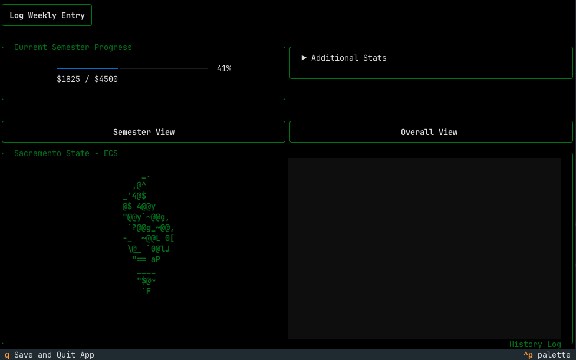

# Uni Financial Tracker
<p align="center">
    
</p>

A terminal-based finance tracker built with **Python** and **Textual** to help monitor university tuition progress throughout a degree. The application focuses on a clean, game-inspired terminal interface while providing persistent financial tracking through JSON save files.

---

## Features

- Semester tuition progress tracking
- Overall university tuition progress
- Weekly payment logging
- Persistent JSON save system
-  Interactive terminal user interface powered by Textual

---

## Screenshots

> *(Add screenshots here as the project evolves.)*

---

## Installation

Clone the repository:

```bash
git clone https://github.com/yourusername/UniFinancialTracker.git
cd UniFinancialTracker
```

Install dependencies:

```bash
uv sync
```

Run the application:

```bash
uv run ui.py
```

Or install it as a global command:

```bash
uv tool install -e .
unifinance
```

---

## Controls

| Key | Action |
|------|--------|
| Q | Save and Quit |
| Enter | Expand / Collapse panels |
| Mouse | Navigate interface |

---

## Project Structure

```text
UniFinancialTracker/
├── assets/
│   └── sacstatelogo.txt
├── saves/
│   └── savefiletest.json
├── datafunctions.py
├── saveload.py
├── ui.py
├── styles.tcss
├── pyproject.toml
└── README.md
```

---

## Technologies

- Python 3
- Textual
- Rich
- pathlib
- JSON
- uv

---

## Goals

This project began as a way to track tuition payments, but it also serves as a learning project for:

- Terminal UI development
- Event-driven application design
- Python application architecture
- Packaging Python applications as CLI tools
- Building maintainable software with Textual

---

## Future Improvements

- ASCII JRPG-inspired interface
- Better payment history visualization
- Financial statistics dashboard
- Multiple save profiles
- Custom semester configuration
- Export payment history
- Theme customization

---

## License

This project is licensed under the MIT License.
